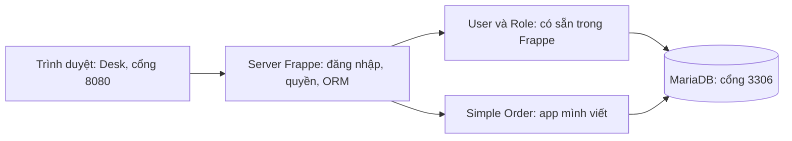

# Hiểu Frappe và phần app đơn hàng mình đã làm

Tài liệu này dùng đúng cấu trúc và các URL của dự án hiện tại, giải thích theo góc nhìn người quen .NET.

Bản local hiện dùng Docker: chạy `docker compose up -d --build --wait`, mở cổng **8080**,
đăng nhập **Administrator / admin**. Bản Bench trong Ubuntu WSL trước đây vẫn ở cổng 8000,
với dữ liệu và mật khẩu riêng.

## 1. Trả lời ngay chỗ đang gây nhầm

**Bạn đang mở một ứng dụng web có giao diện quản trị và các màn hình dữ liệu được dựng sẵn.**
Các bảng trên giao diện có thể trông giống công cụ xem database, nhưng thao tác trên form vẫn đi qua
server Frappe để kiểm tra đăng nhập, quyền và nghiệp vụ trước khi lưu.

| Bạn mở URL nào? | Đây là gì? | Ai cung cấp? |
| --- | --- | --- |
| http://localhost:8080/app/users | Workspace **Users**, nhóm các chức năng quản lý người dùng/quyền | Frappe có sẵn |
| http://localhost:8080/app/user | Danh sách tài khoản của DocType **User** | Frappe có sẵn |
| http://localhost:8080/app/simple-order | Danh sách đơn hàng của DocType **Simple Order** | App `order_management` của mình |
| http://localhost:8080/app/query-report/Daily%20Revenue | Báo cáo doanh thu theo ngày | App `order_management` của mình |

**Muốn xem phần bài test mình đã làm, mở [Simple Order](http://localhost:8080/app/simple-order),
không dùng Workspace Users làm điểm bắt đầu.**

Mình đã kiểm tra metadata của site: Users thuộc module **Core**;
Simple Order thuộc module **Order Management**. Hiện chưa có Workspace riêng cho Order Management.

## 2. Frappe gồm những gì?

Bạn có thể hình dung Frappe là một bộ nền cho ứng dụng quản lý. Nó cung cấp sẵn nhiều phần thường phải
viết khi làm web: đăng nhập, tài khoản, phân quyền, truy cập dữ liệu, API và giao diện quản trị.

Trong một ứng dụng .NET thông thường, bạn có thể tự ghép ASP.NET Core, Identity, EF Core và các trang CRUD.
Frappe đã tích hợp nhiều phần tương tự, đồng thời có một cơ chế khai báo dữ liệu/giao diện gọi là **DocType**.

Các thuật ngữ ở dự án này:

| Tên | Nghĩa cụ thể |
| --- | --- |
| **Frappe Framework** | Mã nền Python/JavaScript để chạy app |
| **Bench** | Môi trường chứa framework, các app, site và công cụ quản lý/chạy chúng |
| **App** | Gói code bổ sung chức năng, ở đây là `order_management` |
| **Module** | Nhóm chức năng trong app, ở đây là `Order Management` |
| **Site** | Một bản hệ thống đang chạy, có cấu hình/database/tài khoản/dữ liệu riêng; ở đây là `orders.localhost` |
| **Desk** | Giao diện quản trị web dùng chung, được truy cập dưới `/app` |
| **Workspace** | Trang nhóm các lối tắt/chức năng trong Desk, ví dụ Users |
| **DocType** | Định nghĩa một loại dữ liệu và cách Frappe xử lý/hiển thị nó |
| **Document** | Một bản ghi cụ thể của DocType, ví dụ đơn `ORD-00006` |

Đây là đối chiếu để làm quen, không phải các thành phần tương đương hoàn toàn với .NET.

## 3. URL `/app/users` có phải đang vào database không?

Phân tích URL bạn đang mở:

```text
http://localhost:8080/app/users
       └─ máy bạn ─┘  └─ đường dẫn trong giao diện Desk
                 ↑
            cổng web 8080
```

- `localhost`: trình duyệt truy cập dịch vụ trên chính máy bạn.
- `8080`: cổng Nginx của bản Docker, chuyển request tới backend Frappe ở cổng 8000 trong mạng Docker.
- `/app`: khu vực giao diện Desk.
- `/users`: Workspace Users, không phải tên database.

Database của app là MariaDB trong container `db`, cổng **3306** của mạng Docker.
Database không mở cổng ra Windows. Trình duyệt gọi Nginx ở 8080, backend mới kết nối MariaDB.



Vì vậy bạn có thể tạo/sửa dữ liệu thật bằng Desk, nhưng thao tác form thông thường không phải
gửi SQL trực tiếp từ trình duyệt. Server vẫn xử lý việc lưu.

So sánh cụ thể:

| Desk | Công cụ quản trị database như SSMS/DBeaver |
| --- | --- |
| Đăng nhập bằng tài khoản ứng dụng như Administrator | Đăng nhập bằng tài khoản database |
| Hiển thị theo DocType, form và quyền ứng dụng | Hiển thị bảng/schema/query theo quyền database |
| Thao tác lưu Document gọi nghiệp vụ Python của app | SQL trực tiếp có thể bỏ qua nghiệp vụ Python |
| Người dùng làm công việc quản lý đơn hàng, người dùng, báo cáo | Người vận hành/dev kiểm tra và quản lý database |

Tài khoản **Administrator của Frappe không phải tài khoản root của MariaDB**.
User `vietanh` của Ubuntu cũng là một tài khoản khác.

## 4. Vì sao Users có sẵn, còn phần mình làm ở đâu?

Frappe đã có các DocType nền như **User** và **Role**. Workspace Users gom các lối tắt tới
quản lý tài khoản, vai trò, quyền và nhật ký. Bạn không cần tự viết lại các chức năng đó cho đề này.

Phần mới mình bổ sung là một app tên `order_management`, có:

1. DocType **Simple Order**: khách hàng, mặt hàng, số lượng, đơn giá, thành tiền, trạng thái.
2. Nghiệp vụ Python: kiểm tra dữ liệu, tính tiền, chuyển trạng thái và khóa đơn.
3. JavaScript trên form: tính nháp, nút Đã giao/Hủy/báo cáo, khóa control khi kết thúc.
4. Tùy biến danh sách: màu trạng thái và nút mở báo cáo.
5. Báo cáo **Daily Revenue**: đếm và cộng tiền các đơn đã giao theo ngày tạo.
6. Test tự động cho các quy tắc trên.

Tất cả được **cài vào cùng site và dùng cùng Desk**, nên các màn hình có cùng thanh menu, kiểu form và nút.
Việc giao diện giống màn hình User là do tái sử dụng giao diện của framework.

Hiện app chưa có Workspace/trang chủ mang tên Order Management trên sidebar.
Module Order Management đã có, nhưng một module không tự đồng nghĩa với một Workspace được thiết kế riêng.
Các điểm vào của bài test hiện là URL đơn hàng, thanh tìm kiếm Desk và nút báo cáo.

## 5. Thử mở đúng phần mình đã làm

1. Đăng nhập bằng Administrator, xem [hướng dẫn tài khoản](HUONG-DAN-TEST.md) nếu cần.
2. Mở [danh sách Simple Order](http://localhost:8080/app/simple-order).
3. Bấm **Add Simple Order** để tạo đơn.
4. Nhập dữ liệu, nhấn Tab để thấy thành tiền nháp, rồi bấm Save.
5. Đơn Mới đã lưu có nút **Đã giao** và **Hủy**.
6. Khi đơn kết thúc, các trường chuyển sang chỉ đọc và không còn nút Save/chuyển trạng thái.
7. Bấm **Doanh thu theo ngày** để mở báo cáo của app.

Bạn cũng có thể tìm **Simple Order** hoặc **Daily Revenue** trong thanh tìm kiếm của Desk.

Ảnh minh họa phần app:

- [Tạo đơn](docs/screenshots/01-create-order.png).
- [Đơn đã giao](docs/screenshots/02-delivered-order.png).
- [Đơn đã hủy](docs/screenshots/03-cancelled-order.png).
- [Báo cáo doanh thu](docs/screenshots/04-daily-revenue.png).

## 6. DocType liên hệ thế nào với form và bảng database?

Với DocType thông thường như **Simple Order**, định nghĩa của nó giúp Frappe biết:

- Có những field nào và lưu kiểu dữ liệu gì.
- Nhãn, thứ tự, trường bắt buộc và trường chỉ đọc trên form.
- Những trường nào hiển thị trong danh sách.
- Vai trò nào được tạo, đọc, sửa hoặc xem báo cáo.

Ví dụ định nghĩa field trong [simple_order.json](order_management/order_management/doctype/simple_order/simple_order.json):

```json
{
  "fieldname": "quantity",
  "fieldtype": "Float",
  "label": "Số lượng",
  "precision": "3",
  "reqd": 1
}
```

Frappe hiểu field này tên `quantity`, có nhãn Số lượng, dùng control số và bắt buộc nhập.
App không cần tự viết một thẻ HTML `<input>` riêng cho nó.

Với hai DocType đang nói tới:

| DocType | Bảng MariaDB thông thường tương ứng | Màn hình danh sách |
| --- | --- | --- |
| User | `tabUser` | `/app/user` |
| Simple Order | `tabSimple Order` | `/app/simple-order` |

Tên bảng có tiền tố `tab` là quy ước của Frappe.
Không phải mọi loại DocType đều ánh xạ thành một bảng độc lập như vậy: Frappe còn có Single/Virtual DocType.
Bảng trên đang nói riêng về User và Simple Order của dự án này.

Một đơn cụ thể có thể được hình dung như:

```text
DocType:       Simple Order
Document name: ORD-00006
customer_name: Khách demo giao hàng
quantity:      2
unit_price:    150000
total:         300000
status:        Đã giao
```

`name` là định danh của Document, gần với `Id` trong một entity .NET.
Frappe còn thêm các field hệ thống như `creation`, `modified`, `owner`.

**File JSON là định nghĩa cấu trúc, không phải file chứa danh sách các đơn đã nhập.**
Tạo một đơn mới thay đổi dữ liệu trong MariaDB; nó không thêm một dòng đơn hàng vào file JSON trong Git.

## 7. Code mình viết nằm ở đâu?

Bạn tiếp tục sửa code ở thư mục Windows:

```text
C:\Users\CytekPC\OneDrive\Desktop\testegeg
```

Các tên khác nhau đang dùng:

| Tên | Vai trò |
| --- | --- |
| `testegeg` | Tên thư mục làm việc trên máy bạn |
| `Gege_ITERPTest_Frappe` | Tên repository GitHub bạn đã chọn |
| `order_management` | Tên package/app Frappe |
| `Order Management` | Tên module nghiệp vụ |
| `Simple Order` | Tên DocType đơn hàng |

Cấu trúc chính:

```text
testegeg/
├── pyproject.toml
├── order_management/                 # package của app
│   ├── hooks.py
│   ├── modules.txt
│   └── order_management/             # module nghiệp vụ
│       ├── doctype/simple_order/
│       │   ├── simple_order.json
│       │   ├── simple_order.py
│       │   ├── simple_order.js
│       │   ├── simple_order_list.js
│       │   └── test_simple_order.py
│       └── report/daily_revenue/
│           ├── daily_revenue.json
│           ├── daily_revenue.py
│           ├── daily_revenue.js
│           └── test_daily_revenue.py
├── tests/
├── .github/workflows/ci.yml
└── README.md
```

Hai thư mục `order_management` lồng nhau là **app → module**, không phải hai bản app khác nhau.

| File | Phần mình đã làm |
| --- | --- |
| [simple_order.json](order_management/order_management/doctype/simple_order/simple_order.json) | Định nghĩa dữ liệu/form, quyền, trạng thái, tên tự sinh |
| [simple_order.py](order_management/order_management/doctype/simple_order/simple_order.py) | Kiểm tra số lượng/đơn giá, tính tiền, kiểm soát trạng thái, khóa đơn ở server |
| [simple_order.js](order_management/order_management/doctype/simple_order/simple_order.js) | Tính nháp, nút giao/hủy/báo cáo, khóa form |
| [simple_order_list.js](order_management/order_management/doctype/simple_order/simple_order_list.js) | Màu trạng thái và nút báo cáo ở danh sách |
| [daily_revenue.py](order_management/order_management/report/daily_revenue/daily_revenue.py) | Truy vấn số đơn và tổng tiền theo ngày tạo, chỉ lấy Đã giao |
| [daily_revenue.json](order_management/order_management/report/daily_revenue/daily_revenue.json) | Đăng ký báo cáo vào Frappe và cấp vai trò xem |
| [hooks.py](order_management/hooks.py) / [modules.txt](order_management/modules.txt) | Khai báo app/module |
| [pyproject.toml](pyproject.toml) | Metadata và đóng gói package Python |
| [ci.yml](.github/workflows/ci.yml) | Kiểm thử/build/đóng gói khi push GitHub |

Framework dùng định nghĩa/callback của app để cung cấp các màn hình bạn đang nhìn thấy.

## 8. Còn thư mục `/home/vietanh/frappe-bench/apps/frappe` là gì?

Đó là mã nguồn **framework Frappe**, được tải vào Ubuntu WSL khi dựng Bench.
Đây là môi trường WSL cũ. Với Docker hiện tại, đường dẫn tương ứng là
`/home/frappe/frappe-bench/apps/frappe` trong container. App của mình nằm ở
`/home/frappe/frappe-bench/apps/order_management`; dùng `docker compose exec backend bash` để xem.
Code Docker được COPY từ thư mục repo lúc build, không liên kết trực tiếp với file Windows.
Sửa code rồi chạy lại `docker compose up -d --build --wait` để cập nhật.

Phần bên dưới mô tả cấu trúc **bản WSL trước đây**, để giải thích đường dẫn bạn đã hỏi:

```text
/home/vietanh/frappe-bench/
├── env/                         # Python virtualenv
├── apps/
│   ├── frappe/                 # framework: User, Role, Desk, ORM, API...
│   └── order_management/       # liên kết tới thư mục Windows của bạn
├── sites/
│   └── orders.localhost/       # cấu hình/file của site
└── logs/
```

Liên kết của app đã được kiểm tra:

```text
apps/order_management → /mnt/c/Users/CytekPC/OneDrive/Desktop/testegeg
```

Liên kết này chỉ áp dụng với bản WSL. Bản Docker cần build lại image sau khi sửa code Windows.

Nếu muốn xem mã framework bằng File Explorer, dán vào thanh địa chỉ:

```text
\\wsl.localhost\Ubuntu\home\vietanh\frappe-bench\apps\frappe
```

Ví dụ mã User có sẵn nằm ở:

```text
/home/vietanh/frappe-bench/apps/frappe/frappe/core/doctype/user/
├── user.json
├── user.py
└── user.js
```

Với bài này, bạn viết tính năng trong app `order_management` để có thể đóng gói/cài lại độc lập;
không cần chỉnh sửa mã User hoặc Desk trong framework.

## 9. Khi bấm Save thì code nào chạy?

Lấy ví dụ bạn tạo một đơn số lượng 2, đơn giá 150000:

1. **Desk dựng form** theo metadata của Simple Order.
2. Bạn nhập liệu; `simple_order.js` nghe sự kiện đổi `quantity` / `unit_price` và tính nháp 300000.
3. Bạn bấm Save; Desk gửi dữ liệu Document tới API lưu của Frappe.
4. Server kiểm tra đăng nhập/quyền và xử lý quy trình lưu Document.
5. Frappe gọi `SimpleOrder.validate()` trong `simple_order.py`.
6. Code app kiểm tra trạng thái đã lưu, từ chối sửa đơn kết thúc, kiểm tra số và tính lại thành tiền.
7. Nếu hợp lệ, Frappe lưu qua ORM vào MariaDB; nếu có lỗi thì trả lỗi thay vì lưu dữ liệu sai.
8. Kết quả trả về được Desk dùng để cập nhật form.

JavaScript hỗ trợ trải nghiệm nhập liệu. **Python ở server quyết định có được lưu hay không.**
`read_only` trên form không thay cho kiểm tra server; người gọi API trực tiếp vẫn phải bị kiểm tra.

Desk có các API nội bộ cho thao tác form. Frappe cũng có REST API cho Document, ví dụ:

```text
GET /api/resource/Simple%20Order
GET /api/resource/Simple%20Order/ORD-00006
```

Đây là các API web cần quyền truy cập phù hợp, không phải đường kết nối database.
Không nên hiểu rằng mọi thao tác Save trên Desk đều dùng đúng hai URL GET ở ví dụ này.

## 10. Vì sao thấy nhiều chức năng hơn đề yêu cầu?

Bạn đang đăng nhập bằng **Administrator**, có quyền quản trị cao trong Frappe.
Do đó bạn thấy Users, Roles, Settings và các công cụ chung của framework, ngoài phần đơn hàng.

Các mục đó không đồng nghĩa app đơn hàng đã có thêm nghiệp vụ nhân sự, kế toán hoặc bán hàng đầy đủ.
Chúng là chức năng nền dùng chung của site.

User/Role quản lý **ai được đăng nhập và làm gì**. Trường Khách hàng trên đơn hiện chỉ là **tên khách hàng**,
không phải tự động tạo một tài khoản User cho khách đó.

Một site có thể cài nhiều app và các DocType của chúng cùng nằm trong database của site.
Không mặc định tạo một database riêng cho mỗi app. Site mới có database/tài khoản/dữ liệu riêng.

## 11. Đối chiếu nhanh với .NET

| Khái niệm quen trong .NET | Cách hình dung trong Frappe |
| --- | --- |
| ASP.NET Core / các thư viện nền | Frappe Framework |
| ASP.NET Identity User/Role | User/Role có sẵn của Frappe |
| Entity + mapping + metadata form | DocType JSON |
| Một entity instance | Một Document |
| ORM, lưu entity | ORM và `Document.save()` của Frappe |
| Nghiệp vụ/validation trước SaveChanges | `SimpleOrder.validate()` |
| Trang CRUD Razor/Blazor được dựng từ model | Form/list Desk được dựng từ DocType |
| Event handler trên UI | Form Script JavaScript |
| `.csproj` / package metadata | `pyproject.toml` |
| Cập nhật schema bằng migration | `bench migrate` đồng bộ DocType; data migration riêng dùng patches |

`SimpleOrder` được Frappe gọi là controller của Document. Nó không phải HTTP Controller kiểu ASP.NET MVC.
Trong thiết kế hiện tại, bạn không phải tự viết HTTP Controller cho mỗi thao tác CRUD cơ bản.

## 12. Tự đi theo code trong 5 phút

1. Mở [Simple Order](http://localhost:8080/app/simple-order), nhìn các trường trên form.
2. Mở `simple_order.json`, đối chiếu từng `fieldname`/`label` với form.
3. Đổi số lượng trên một đơn Mới, nhấn Tab; mở `simple_order.js` để tìm phép tính nháp.
4. Bấm Save; mở `simple_order.py` để tìm phép tính chính thức và kiểm tra `quantity <= 0`.
5. Mở báo cáo; đọc `daily_revenue.py`, tìm điều kiện `status = Đã giao` và nhóm `DATE(creation)`.
6. Quay lại `/app/users` để nhận ra đây là một nhóm chức năng khác, được framework cung cấp sẵn.

Sau bước này, bạn có thể chỉ đúng: **giao diện chung từ Frappe, định nghĩa và nghiệp vụ đơn hàng từ app,
dữ liệu đơn hàng được lưu trong MariaDB**.

Tài liệu liên quan:

- [Tài khoản và luồng test](HUONG-DAN-TEST.md).
- [Cách viết JavaScript trên form](docs/frappe-frontend.md).
- [README dự án](README.md).
- Tài liệu chính thức: [Desk](https://docs.frappe.io/framework/user/en/desk),
  [DocType](https://docs.frappe.io/framework/user/en/basics/doctypes),
  [Apps](https://docs.frappe.io/framework/user/en/basics/apps),
  [REST API](https://docs.frappe.io/framework/user/en/api/rest).
