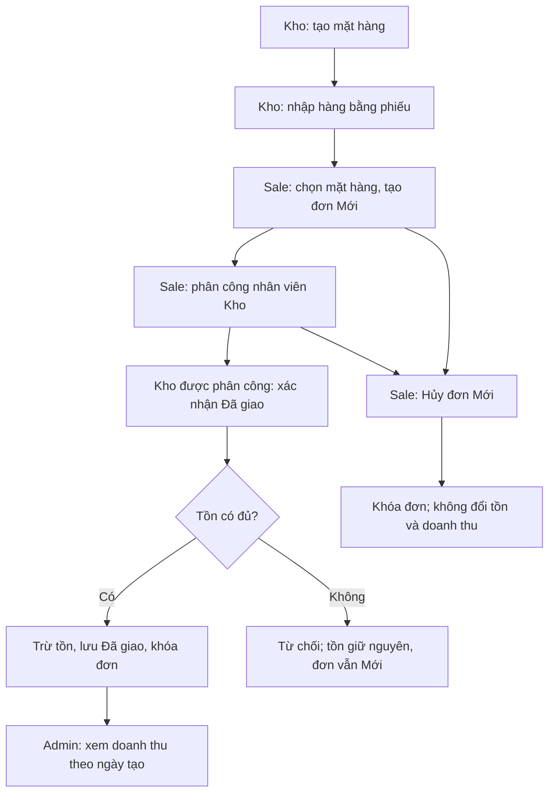

# Phân quyền Sale – Kho và tồn kho

App có ba nhóm: Admin (Administrator), Sale (Order Sales), Kho (Order Warehouse).
Role và schema tự cài khi install/migrate app; không sửa mã framework Frappe.

| Chức năng | Admin | Sale | Kho |
| --- | --- | --- | --- |
| Xem đơn | Tất cả | Chỉ đơn mình tạo | Chỉ đơn được phân công |
| Tạo đơn | Có | Có | Không |
| Sửa đơn Mới, phân công kho | Mọi đơn | Đơn mình tạo | Không |
| Hủy đơn Mới | Mọi đơn | Đơn mình tạo | Không |
| Xác nhận Đã giao | Có | Không | Đơn được phân công |
| Xem báo cáo doanh thu | Có | Không | Không |
| Xem danh mục/tồn kho | Có | Có | Có |
| Quản lý mặt hàng, nhập kho | Có | Không | Có |
| Xem lịch sử nhập/xuất kho chung | Có | Không | Có |
| Sửa tồn trực tiếp hoặc sửa/xóa phiếu nhập đã lưu | Không | Không | Không |
| Sửa/xóa đơn đã kết thúc | Không | Không | Không |

Chỉ Admin xem toàn bộ **đơn hàng và doanh thu**. Danh mục và tồn kho dùng chung một kho,
nên Sale/Kho được đọc danh mục; các nhân viên Kho cùng quản lý hàng và phiếu nhập.
`System Manager` không thay thế quyền Admin trong app.

## Luồng

Có thể lưu đơn chưa phân công; chỉ Kho được phân công mới xuất được đơn, Admin được thao tác khi cần.
Đổi người xử lý khi đơn Mới sẽ thu hồi quyền của người cũ. Đơn đã kết thúc chỉ xem.

## Dữ liệu

- **Stock Item** → `tabStock Item`: mã, tên, đơn vị, giá mặc định, đang sử dụng, tồn chỉ đọc.
- **Stock Receipt** → `tabStock Receipt`: mặt hàng, số lượng nhập, tồn sau nhập, ghi chú; lưu xong bất biến.
- **Stock Movement** → `tabStock Movement`: lịch sử nhập/xuất bất biến; bản ghi Xuất là phiếu xuất `OUT-…`, ghi chứng từ nguồn, số lượng, tồn trước/sau và người thực hiện. Tự tạo cùng giao dịch nhập/giao đơn; chứng từ nguồn có unique index.
- **Simple Order** → `tabSimple Order`: tham chiếu mặt hàng bằng `item`, lưu tên mặt hàng trên đơn,
  dùng `owner` làm người tạo và `warehouse_user` làm người xử lý kho.
- **Daily Revenue**: chỉ Administrator chạy được; chỉ cộng đơn Đã giao theo ngày tạo.

Migrate liên kết đơn cũ với mã `OLD-...`, không đổi trạng thái và không tự cộng/trừ tồn cho lịch sử.
Mặt hàng tạo mới có tồn 0; phải lập phiếu nhập để có hàng xuất.
Không tự xóa mặt hàng: bỏ chọn Đang sử dụng để giữ tham chiếu lịch sử.

## Chống race condition

1. Frappe đọc dòng đơn bằng `FOR UPDATE`, kiểm tra `modified` để từ chối bản cập nhật cũ.
2. Server kiểm tra quyền dựa trên người tạo/người xử lý đang lưu trong DB và bản đơn đã khóa.
   Sửa `owner` hoặc `warehouse_user` trong request không tự cấp quyền.
3. Cập nhật tồn khóa đúng dòng mặt hàng bằng `SELECT ... FOR UPDATE`.
   Phiếu nhập và các đơn cùng một mặt hàng dùng chung khóa này.
4. Trạng thái đơn, phiếu nhập, lịch sử/phiếu xuất và số tồn dùng transaction của request.
   Không commit giữa chừng; lỗi làm rollback toàn bộ.
5. Hai yêu cầu giao cùng một đơn chỉ được trừ tồn một lần.
   Hai đơn tranh số tồn cuối chỉ một đơn thành công; đơn thất bại vẫn Mới.

Test server mở hai kết nối DB độc lập để chạy đồng thời; browser test còn gửi hai request HTTP
từ hai nhân viên Kho vào cùng một mặt hàng. Có test rollback, phân công lại và API giả mạo quyền.

Quyền danh sách và từng Document dùng
[permission hooks của Frappe](https://docs.frappe.io/framework/user/en/python-api/hooks#document-permissions).
Role/DocType permissions theo
[Users and Permissions](https://docs.frappe.io/framework/user/en/basics/users-and-permissions).
Không cấp quyền chia sẻ đơn tùy ý, không chỉ ẩn nút ở frontend.

## Giới hạn bản đầu

Chi tiết trạng thái, seed và giả định gửi/giao hàng: [Luồng đơn và kho](stock-flow.md).
Lịch sử nhập/xuất bắt đầu từ bản cập nhật này; không tự dựng lại giao dịch cũ.

Một kho chung, một mặt hàng mỗi đơn. Chưa giữ chỗ tồn cho đơn Mới, hoàn/đổi hàng,
điều chỉnh tồn, chuyển kho, giá vốn, lô/hạn sử dụng hoặc quy trình phê duyệt.
Tài khoản, hàng và đơn mẫu tự seed khi install/migrate ở cả Bench và Docker;
xem [hướng dẫn test](../HUONG-DAN-TEST.md). Đổi mật khẩu demo trước khi mở web công khai.
